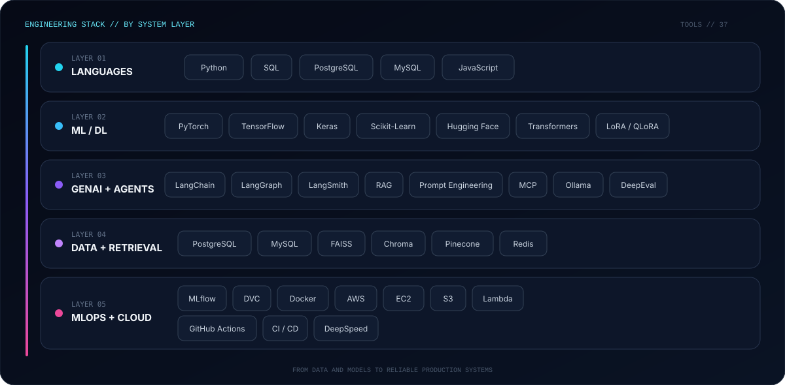
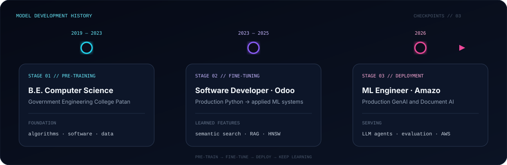

  &nbsp;
  &nbsp;
  

 

## `01. AGENT COMMAND CENTER`

A production GenAI system is a continuous control loop. The orchestrator plans and routes work across retrieval, tools, memory, guardrails, tracing, and evaluation. Production feedback returns to the system as the next improvement signal.

 

## `02. SELECTED BUILDS`

 

## `03. ENGINEERING STACK`

The tools are grouped by the role they play in an AI system, from language and model development to retrieval, evaluation, infrastructure, and delivery.

 

## `04. MODEL DEVELOPMENT HISTORY`

  <strong>Kaggle Notebook Expert · Top 7% globally</strong> 
  Technical mentor to 40+ developers across 10+ teams at the Odoo India Hackathon

---

  <samp>retrieve → reason → evaluate → ship → observe → improve</samp>

