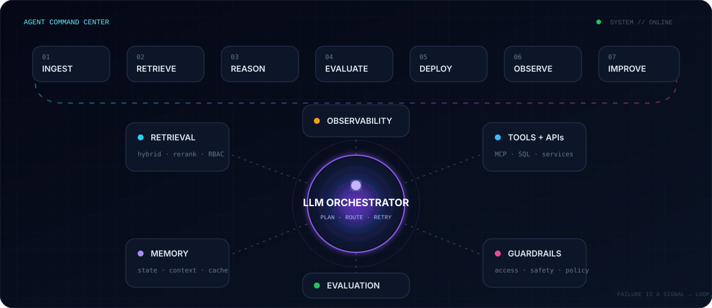

<p align="center">
  <a href="mailto:shubhsmit11@gmail.com"></a>&nbsp;
  <a href="https://linkedin.com/in/shubham-patel"></a>&nbsp;
  <a href="https://kaggle.com/shubham1111"></a>
</p>

<br/>

## `01. SYSTEM PROFILE`

I’m an **ML Engineer with 3.4+ years of experience** turning language-model prototypes into production systems. My work sits at the intersection of **retrieval, agent orchestration, evaluation, and MLOps**, with a focus on measurable quality rather than impressive demos.



<br/>

## `02. THE SYSTEMS I BUILD`



<br/>

## `03. SELECTED BUILDS`

<table>
<tr>
<td width="50%" valign="top">

### `⌕` Semantic Code Search

Indexed **200K+ code snippets** with CodeBERT and FAISS, exposed through FastAPI with PostgreSQL metadata.

**`< 50 ms`** query latency &nbsp;·&nbsp; **`+34%`** MRR@10 vs BM25

`CodeBERT` `FAISS` `FastAPI` `PostgreSQL`

</td>
<td width="50%" valign="top">

### `▤` LLM Text-to-SQL

Built schema-aware SQL generation with query validation, safety controls, and a self-healing retry loop.

**`< 2%`** hallucinated columns &nbsp;·&nbsp; **`~80%`** failed queries repaired

`Gemini` `LangChain` `SQLAlchemy` `DeepEval`

</td>
</tr>
</table>

<br/>

## `04. ENGINEERING TOOLKIT`

<p align="center">
  
</p>

<p align="center">
  
  
  
  
  
  
  
  
</p>

<br/>

## `05. EXPERIENCE SNAPSHOT`

```text
2026          ML Engineer          Amazo Healthcare
              Financial-document extraction · LLM agents · evaluation pipelines

2023—2025     Software Developer   Odoo India
              Semantic search · support-ticket RAG · production Python
```

> **Kaggle Notebook Expert — Top 7% globally** · Technical mentor to **40+ developers across 10+ teams** at the Odoo India Hackathon.

---

<p align="center">
  <samp>retrieve → reason → evaluate → ship → observe → improve</samp>
</p>
